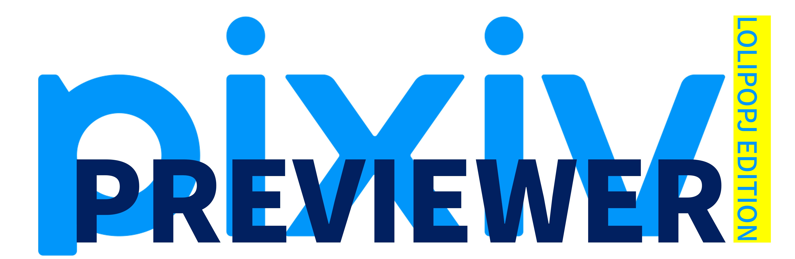
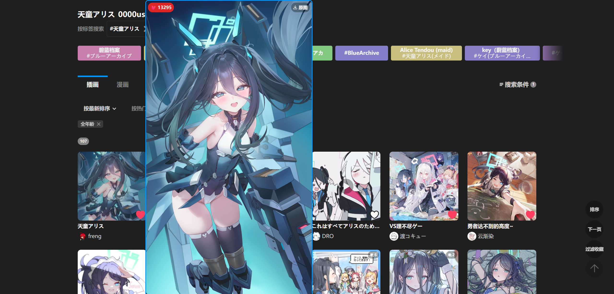
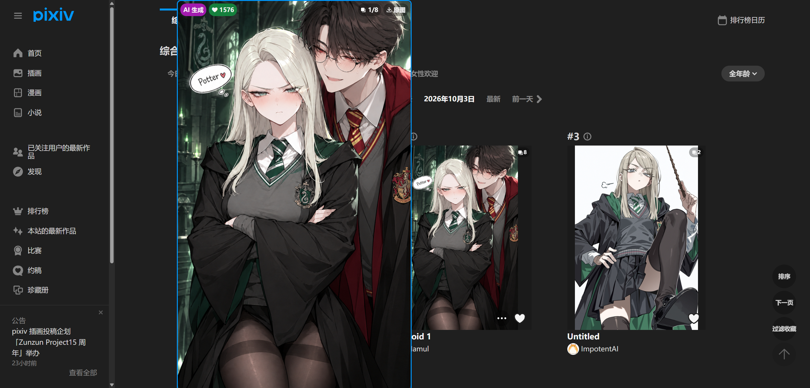
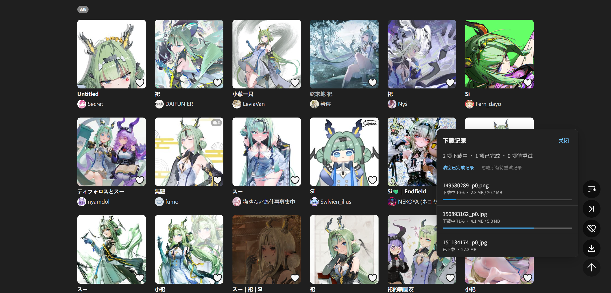
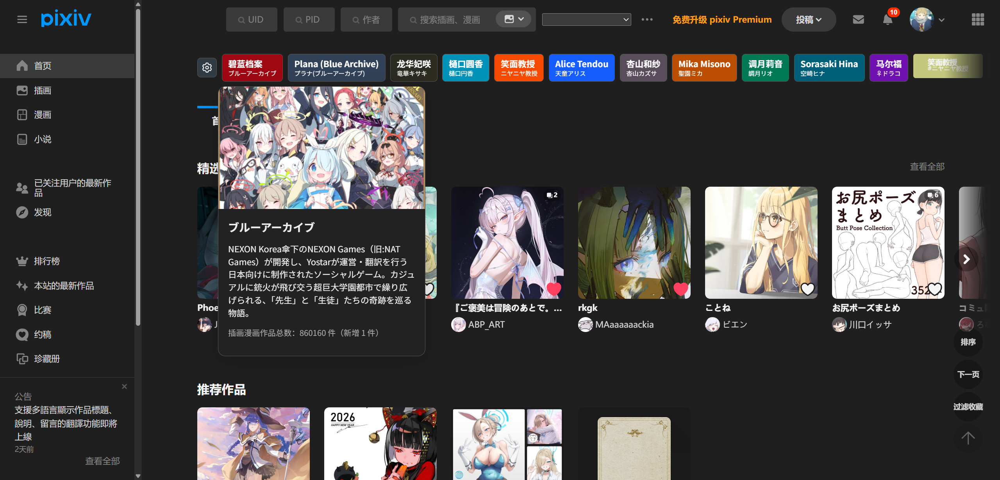

<h3 align="center">
  <a name="readme-top"></a>
  
</h3>

<div align="center">
  <a href="https://greasyfork.org/en/scripts/533844">
    
  </a>
  <a href="https://github.com/LolipopJ/PixivPreviewerL">
    
  </a>
</div>

---

English | [中文](./README.zh.md)

# Pixiv Previewer (LolipopJ Edition)

> Original project: [Ocrosoft/PixivPreviewer](https://github.com/Ocrosoft/PixivPreviewer), original userscript page: [Pixiv Previewer](https://greasyfork.org/en/scripts/30766)

As a moderate Pixiv digital hoarder, Ocrosoft/PixivPreviewer has been a huge productivity booster and one of my essential browser extensions. I forked the project, modernized its frontend tooling, and now maintain it strictly according to **my own preferences**.

😥 Because of my opinionated choices, this fork has the following trade-offs compared to the original project:

- **No novel support.** I do not use Pixiv to read novels, so novel-related features are neither developed nor maintained.
- **Fewer configuration options.** Settings for features I do not personally use are removed rather than maintained.
- **Narrower browser compatibility.** The build targets `Chrome >= 107`; compatibility with older Chrome versions or other browsers is not guaranteed.

🥰 This repository refactors the original project and focuses on the following improvements:

- **Artwork previews across all pages.** Hovering over any image link that leads to an artwork page opens a preview window.
  
- **Sorting on more pages.** Adds sorting support to pages where it is useful, such as a user's bookmarked artworks and new artworks from followed artists.
- Improved development ergonomics and type safety.

🤗 In addition, I added the following features for my own workflow:

- **Metadata in the preview window.** Displays bookmark counts and AI-generated badges at the top of the preview window.
  
- **One-handed preview mode.** Long-press the mouse button while a preview window is open to enter one-handed mode—equivalent to holding `Ctrl`/`Command`—keeping the preview open after releasing the mouse. Press `Esc` or click outside the preview window to exit.
- **Download history panel for original images.** Click the "Download history" button in the bottom-right toolbar to track original-image download progress and quickly retry downloads interrupted by network drops or closed tabs. Download state is shared across all open Pixiv tabs, so you can check progress or retry interrupted downloads from any tab.
  
- **Rating-based subdirectories for original-image downloads.** When Tampermonkey's "Download Mode" is set to "Browser API", rated artworks (`R-18` / `R-18G`) are automatically saved into corresponding subdirectories under your default downloads folder, helping organize downloaded artworks during initial triage.
- **Hide bookmarked artworks on the current page.** Click the "Hide bookmarked artworks" button in the bottom-right toolbar to hide artworks already marked with a heart on the current page, making it easier to discover new works.
- **Local tag management.** Save and organize favorite tags locally without Pixiv's 10-tag limit for free accounts; hover over any tag to view its details and see how many new works were added since your last visit.
  
- **Multi-layered local caching.** By default, data is cached locally using the following policies (configurable under "Settings → Advanced settings → Cache"):

  | Data                                                      | Storage         | Default TTL   | Default Limit                                               |
  | --------------------------------------------------------- | --------------- | ------------- | ----------------------------------------------------------- |
  | Artwork details (static fields: title, tags, page count)  | IndexedDB       | 30 days       | 5,000 entries                                               |
  | Artwork details (mutable fields: bookmark count & status) | IndexedDB       | 6 hours       | Same as above (previews tolerate up to 24 hours extra)      |
  | Image pages (preview image URLs)                          | IndexedDB       | 7 days        | 1,500 entries                                               |
  | Ugoira frames                                             | IndexedDB       | 7 days        | 20 artworks / 64 MiB                                        |
  | Tag details and Chinese translations                      | `GM_setValue`   | 30d / 7d      | 2,000 entries (evicts oldest down to `floor(capacity / 2)`) |
  | User artwork lists                                        | Session Storage | 3 hours       | Per-tab lifecycle                                           |
  | In-memory preview metadata cache (image pages / Ugoira)   | Memory          | Page lifetime | 100 entries each                                            |
  | Decoded preview images                                    | Memory          | Page lifetime | 10 images (2× the preload window of 5 images)               |

  Artworks published within the last 1 hour (by default) are not cached so early metadata does not get frozen. Visiting an artwork page automatically invalidates the cached details for that artwork.

  Right-click the Tampermonkey icon and select "Clear cache" to purge all local caches, or "Cache usage" to inspect current entry counts.

## Compatibility

`Chrome >= 107` (2022-10-25); older Chrome versions and other browsers are untested.

## Installation

To get the same experience, install the script from [PixivPreviewerL on Greasy Fork](https://greasyfork.org/en/scripts/533844), or import the prebuilt userscript [`dist/pixiv-previewer-l.user.js`](./dist/pixiv-previewer-l.user.js) directly into Tampermonkey.

[Pixiv Plus](https://greasyfork.org/en/scripts/34153) is another essential userscript in my browser. This project is designed to remain compatible with Pixiv Plus and avoids duplicating its features, so you can safely enable both scripts at the same time.

## Limitations

Because Pixiv enforces **strict API rate limits**, it is recommended to keep "Pages per sort" at the default of 2 pages to reduce the risk of triggering rate limiting.

If sorting stays on the loading spinner (retrying requests) or you temporarily cannot view or bookmark artworks, please wait for Pixiv's rate limit to lift.

## Development

Install dependencies:

```bash
pnpm install
```

Edit source files under `src/` to develop and maintain the script; edit the `banner` option in `tsdown.config.ts` to update the Tampermonkey userscript metadata.

Lint and format the codebase:

```bash
pnpm run lint     # Fix code quality and formatting issues
pnpm run prettier # Format all files with Prettier
```

Build the distributable userscript at `dist/pixiv-previewer-l.user.js`:

```bash
pnpm run build
```
