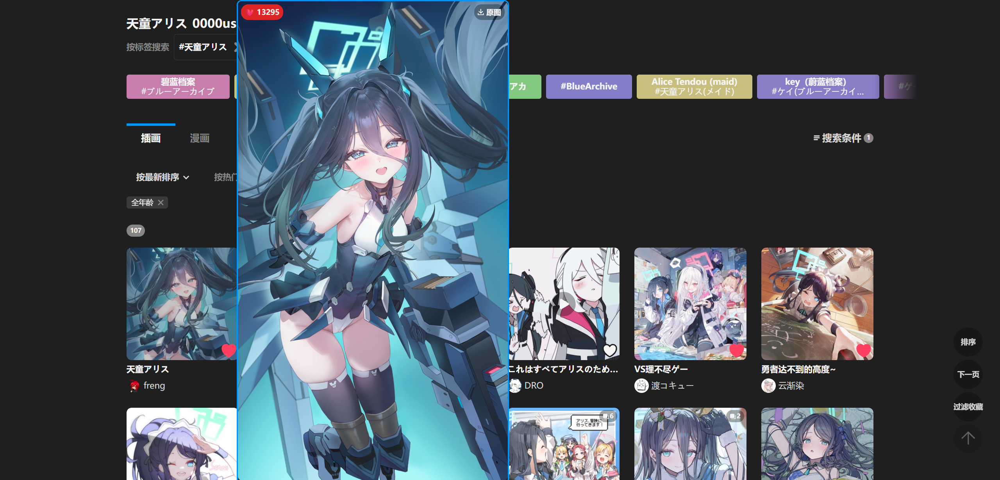
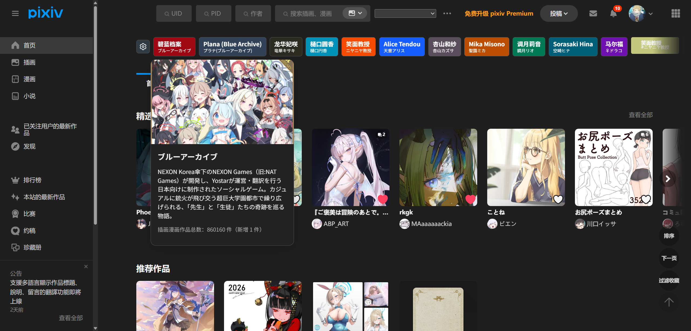

<h3 align="center">
  <a name="readme-top"></a>
  
</h3>

<div align="center">
  <a href="https://greasyfork.org/zh-CN/scripts/533844">
    
  </a>
  <a href="https://github.com/LolipopJ/PixivPreviewerL">
    
  </a>
</div>

---

[English](https://github.com/LolipopJ/PixivPreviewerL/blob/master/README.md) | 中文

# Pixiv Previewer (LolipopJ Edition)

> 原项目：[Ocrosoft/PixivPreviewer](https://github.com/Ocrosoft/PixivPreviewer)，原插件页面：[Pixiv Previewer](https://greasyfork.org/zh-CN/scripts/30766)

我是 Pixiv 中度仓鼠症，Ocrosoft/PixivPreviewer 带给我很大的效率提升，是我的浏览器的必备插件之一，因而我 Fork 了该项目并进行了现代前端工程化改造，并彻底按照**自己的喜好**对此项目进行开发维护。



😥 由于我的自以为是，相比原项目，此项目里的插件有如下退化：

- **不支持小说相关内容。** 我不使用 Pixiv 浏览小说，所以不会对小说相关内容进行开发与维护。
- **较少的可配置项。** 我自己用不着的功能配置项也不会进行开发维护，而是直接删除。
- **更低的浏览器兼容性。** 构建产物目标为 `Chrome >= 107`，不保证较低版本 Chrome 以及其他浏览器的兼容性。

🥰 此仓库重构了原有项目，并专注于解决如下问题：

- **为我认为可以支持排序的页面添加排序功能。** 例如用户收藏作品、关注画师的新作品等页面。
- 提升插件开发效率和代码安全性。

🤗 另外，相比原插件，我额外添加了如下满足自身需要的功能：

- **在作品预览窗口显示元数据信息。** 目前会在作品预览窗口的顶部展示“收藏数”和“AI 生成”信息。
  
- **作品预览添加单手模式。** 显示作品预览窗口时，鼠标长按进入单手模式，相当于长按 `Ctrl`/`Command` 键，保持窗口显示。按 `Esc` 或点击预览窗口外部退出。
- **新增列表管理原图下载。** 点击右下角工具栏的“下载记录”按钮，可以追踪原图下载的进度，对因网络断连或网页关闭导致的下载中断问题，能快速发起重试。下载状态在所有 Pixiv 标签页之间共享，可在任意标签页查看进度、重试中断的下载。
  
- **下载不同分级原图到对应子目录。** 当启用 Tampermonkey 的「浏览器 API」下载模式时，自动将分级作品保存到默认下载文件夹的子目录中。对于使用不同文件夹管理分级作品的屯屯鼠来说，能够起到初筛分类的作用。
- **过滤当前页面已收藏的作品。** 点击右下角工具栏的“过滤收藏”按钮，可以隐藏当前页面里已标注爱心的作品，提升发现更多优质作品的效率。
- **本地标签管理。** 支持将喜欢的标签放在本地管理，不受普通用户 10 个收藏标签上限的限制；悬浮本地标签即可查看标签详情及相比上次访问新增的作品数。
  
- **优化后的缓存能力。** 插件默认按以下策略在本地缓存数据（可在设置面板「高级设置 → 缓存」中调整）：

  | 数据                                   | 存储位置        | 默认有效期   | 默认上限                              |
  | -------------------------------------- | --------------- | ------------ | ------------------------------------- |
  | 作品详情（标题、标签、页数等静态字段） | IndexedDB       | 30 天        | 5000 条                               |
  | 作品详情（收藏数、收藏状态等可变字段） | IndexedDB       | 6 小时       | 同上（预览可额外容忍 24 小时）        |
  | 作品分页（预览图片链接）               | IndexedDB       | 7 天         | 1500 条                               |
  | 动图帧                                 | IndexedDB       | 7 天         | 20 个作品 / 64 MiB                    |
  | 标签详情与中文翻译                     | `GM_setValue`   | 30 天 / 7 天 | 2000 条（超限按容量一半向下取整淘汰） |
  | 用户作品列表                           | Session Storage | 3 小时       | 随标签页                              |
  | 预览内部元数据缓存（分页/动图）        | 内存            | 页面生命周期 | 各 100 条                             |
  | 预览图片解码结果                       | 内存            | 页面生命周期 | 10 张（按预加载数量 5 张的 2 倍计算） |

  发布未满默认 1 小时的作品不会缓存详情，以免固化发布初期的信息。访问作品详情页时会主动让该作品的详情缓存失效。

  可以右键 Tampermonkey 图标选择「清除缓存」清空全部本地缓存，或选择「缓存占用」查看当前条目数。

## 兼容性

`Chrome >= 107`（2022.10.25）；较低版本 Chrome 以及其他浏览器的兼容性未测试。

## 安装

如果您想获取跟我一样的体验，那么请看插件页面 [PixivPreviewerL](https://greasyfork.org/zh-CN/scripts/533844)。或者直接在 Tampermonkey 上导入已经打包好的插件代码：[`dist/pixiv-previewer-l.user.js`](https://github.com/LolipopJ/PixivPreviewerL/blob/master/dist/pixiv-previewer-l.user.js)。

[Pixiv Plus](https://greasyfork.org/en/scripts/34153) 是另一个我在浏览器上的必备插件，在兼容它的同时，对此插件的维护开发也将避免做与它重复的工作。您可以放心地同时启用这两个插件。

## 限制

由于 Pixiv 对**接口访问频率的限制**，作品排序功能建议使用默认的页数 —— 2 页，降低被风控限流的风险。

如果遭遇限流，按经验来说需要等待 120 秒才能解除。

## 开发

安装项目依赖：

```bash
pnpm install
```

开发与维护插件，可编辑 `src/` 目录里的源码；修改 Tampermonkey 的元数据，可编辑 `tsdown.config.ts` 中的 `banner` 配置。

查找并修复质量或格式问题：

```bash
pnpm run lint     # 修复代码质量与格式问题
pnpm run prettier # 修复代码的格式问题
```

打包为可发布文件 `dist/pixiv-previewer-l.user.js`：

```bash
pnpm run build
```
